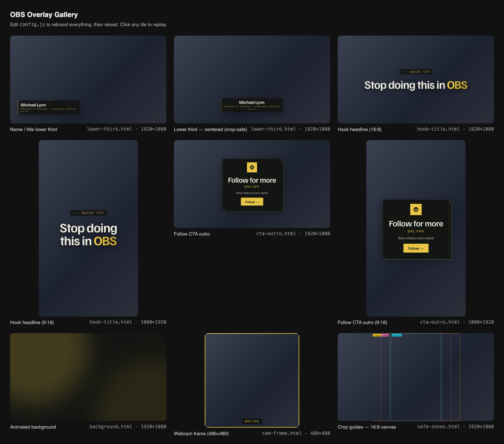

# OBS Social Media Kit

Record once in OBS at 16:9, then export vertical, square, feed and landscape cuts from the same file. A second set of scenes and backgrounds brands your Google Meet and Zoom calls.



*The overlays as shown in `overlays/index.html`. Edit `overlays/config.js` to change the name, colors and fonts.*

```
overlays/            Browser Source overlays (transparent HTML, 1920×1080 unless noted)
  config.js          ← edit this to brand everything (name, handle, colors, font, timings)
  index.html         gallery that previews every overlay
  lower-third.html   animated name/title bar, hides itself after 6s
  hook-title.html    big headline for the first 2–3s of a short (works 16:9 and 9:16)
  cta-outro.html     "Follow @handle" end card
  cam-frame.html     gold ring for the webcam bubble
  background.html    slow animated brand gradient for behind your screen or cam
  safe-zones.html    crop guides and platform UI zones. Keep it hidden while recording
  meeting-*.html     meeting overlays: name tag, agenda bar, starting soon, be right back
  meeting-control.html  OBS dock that changes the meeting overlays live
  masks/             PNG masks for rounded or circular webcams
meeting-backgrounds/ ready-to-upload Meet / Zoom backgrounds (dark & light) + render.sh
brands/              optional employer/client brand profiles (brands/private/ is gitignored)
obs/
  build_collection.py   builds the "Social Media Kit" scene collection
  build_meetings.py     builds the "Meetings" scene collection and adds the Meeting Control dock
  startup-scene.lua     opens each collection on a set scene every time OBS starts
  *.json                generated by the builders (not committed: has absolute paths and device IDs)
scripts/
  social-export.sh   recording → 9:16 / 4:5 / 1:1 / 16:9 MP4s, loudness-normalized
  thumbnails.sh      picks the best frames and makes a contact sheet for cover images
```

---

## 1. Fix your OBS output settings first

Record at full 1080p. If the output is scaled down to 720p, a 9:16 crop is only 405 px wide and looks soft.
OBS's default profile often downscales to 720p, so check this first. Recommended settings:

| Setting | Where | Value |
|---|---|---|
| Base (canvas) resolution | Settings → Video | **1920×1080** |
| Output (scaled) resolution | Settings → Video | **1920×1080**. Don't downscale. |
| FPS | Settings → Video | 30, or 60 for fast screen/gameplay content |
| Output mode | Settings → Output | **Advanced** |
| Recording format | Output → Recording | Hybrid MP4 (or Hybrid MOV, which you use now) |
| Encoder | Output → Recording | Apple VT H.264 (or HEVC for smaller files) |
| Rate control / quality | Output → Recording | CRF / Quality **≈ 70–75** (VT) or CRF **18** (x264) |
| Audio sample rate | Settings → Audio | 48 kHz |
| Record hotkey | Settings → Hotkeys → Start/Stop Recording | e.g. ⌃⌥R |

## 2. Load the scene collection

```bash
python3 obs/build_collection.py --install
```

Quit OBS first. Then open OBS → **Scene Collection → Social Media Kit**.
(Alternative: run without `--install`, then go to **Scene Collection → Import** and pick `obs/Social-Media-Kit.json`.)

The script reuses the camera and display already chosen in the installed kit, or failing that, the camera from your other collections. After loading:

1. Double-click **Screen** and pick your display. macOS will ask for Screen Recording permission.
2. Double-click **Camera** to confirm the device.
3. Check **Mic** in the audio mixer. It already has Noise Suppression (RNNoise), then Compressor 4:1, then Limiter −1.5 dB.

### Scenes and hotkeys

| Hotkey | Scene | Use |
|---|---|---|
| ⌃⌥1 | **1 · Hook** | Full cam plus big headline. Record the first 2–3 s here. |
| ⌃⌥2 | **2 · Talking Head** | Full cam. ⌃⌥L shows the lower third, ⌃⌥⇧L hides it. |
| ⌃⌥3 | **3 · Screen + Cam** | Screen over the animated background, rounded cam bubble bottom-right. |
| ⌃⌥4 | **4 · Outro CTA** | Follow card. |
| ⌃⌥G / ⌃⌥⇧G | (scenes 2 & 3) | Show/hide the **Safe Zones** guide. Hide it before you hit record. |

`[nested] Cam Bubble` is a helper scene that holds the rounded webcam. You don't switch to it.

OBS normally reopens on the last scene you used. The kit's `obs/startup-scene.lua` script switches to **2 · Talking Head** about a second after launch instead. To pick another scene, or remove the script, use **Tools → Scripts → startup-scene.lua**.

Overlays replay their intro animation each time a scene becomes active. To replay one by hand, hide and show its source (eye icon), or right-click it → Interact and click.

## 3. Brand it

Edit `overlays/config.js` (name, role, handle, hook text, CTA, colors, font), save, then in OBS right-click a browser source → **Refresh**. To preview the overlays outside OBS, open `overlays/index.html` in a browser.

Per-source overrides go after the file path, e.g. a guest lower third:
`lower-third.html#name=Ada%20Lovelace&role=Guest&handle=@ada`

**Planning to post vertical?** Set `lowerThirdAlign: "center"` so the lower third survives the 9:16 crop. Keep faces and text inside the cyan 9:16 box on the Safe Zones guide.

## 4. Export for each platform

```bash
scripts/social-export.sh --latest                       # newest file in ~/Movies → 9:16
scripts/social-export.sh talk.mov -f all                # vertical + feed + square + landscape
scripts/social-export.sh talk.mov -f vertical -x 0.7    # aim the crop right of center
scripts/social-export.sh talk.mov -s 3.5 -e 58          # trim to 0:03.5–0:58
scripts/social-export.sh demo.mov -m blur -f square     # show the whole frame, blurred fill
scripts/social-export.sh demo.mov --hw -f all           # Apple hardware encode (fast)
```

**Screen + Cam recordings → vertical stack** (cam on top, screen below), using the rectangles from scene 3:

```bash
scripts/social-export.sh demo.mov -m stack --cam 1480:640:400:400 --screen 48:158:1824:764
```

`--screen` is where your display actually lands in the frame. It depends on the shape of the captured display, because OBS fits it inside the 1824×1000 box at (48, 40):

| Captured display | `--screen` |
|---|---|
| 3440×1440 ultrawide | `48:158:1824:764` |
| 16:9 (e.g. 1920×1080) | `71:40:1778:1000` |
| 16:10 MacBook (e.g. 2056×1329) | `186:40:1547:1000` |

If you change displays, use the matching row, or work it out: scale = min(1824 / width, 1000 / height); w = width × scale; h = height × scale; x = 48 + (1824 − w) / 2; y = 40 + (1000 − h) / 2.

Exports go to `exports/` next to the source file as H.264 + AAC MP4s with faststart, normalized to −14 LUFS / −1 dBTP, which is the loudness the major platforms target. Run `scripts/social-export.sh --help` for every option.

**Cover images:** `scripts/thumbnails.sh --latest 12` writes 12 candidate frames plus a contact sheet.

### Platform cheat sheet

| Platform | Export | Length sweet spot | Notes |
|---|---|---|---|
| TikTok / Reels / Shorts | `vertical` | 15–60 s | Keep text in the green safe box (vertical Safe Zones guide). |
| Instagram / LinkedIn feed | `feed` (4:5) | 30–90 s | Takes up the most feed height. |
| X / LinkedIn / Facebook | `square` or `landscape` | ≤ 2 min | Most viewers watch muted, so turn on auto-captions. |
| YouTube | `landscape` | any | Make a cover with `thumbnails.sh`. |

## 5. Recording workflow

1. Turn on Safe Zones (⌃⌥G), frame yourself, then turn it off (⌃⌥⇧G).
2. Start recording on **1 · Hook** and say the hook line while the headline is on screen.
3. Cut to **2 · Talking Head** or **3 · Screen + Cam** for the content, and tap ⌃⌥L to show your name.
4. End on **4 · Outro CTA** for 2–3 s.
5. `scripts/social-export.sh --latest -f all` and `scripts/thumbnails.sh --latest`.

### Want to record natively in 9:16?

Install the free **Aitum Vertical** plugin. It adds a second 1080×1920 canvas that records alongside the main one. All overlays except the lower third adapt to a 1080×1920 browser source. On that canvas, `safe-zones.html` shows where TikTok, Reels and Shorts UI covers the video.

## 6. Meetings: Google Meet & Zoom

Two ways to brand your calls. Use either or both.

### Option A: Upload a background (no OBS needed)

`meeting-backgrounds/` has six 1920×1080 images in dark and light, matching mlynn.org:

| | Plain | Name | Book a call |
|---|---|---|---|
| Dark | `dark-plain.png` | `dark-name.png` | `dark-booking.png` |
| Light | `light-plain.png` | `light-name.png` | `light-booking.png` |

- **Google Meet:** ⋮ More options → Apply visual effects → Backgrounds → **＋ Add**.
- **Zoom:** Settings → Background & effects → Virtual backgrounds → **＋ Add image**.

Text sits in the top band and corners, because the app cuts you out of the middle of the frame. Your self-view is mirrored, so the text looks backwards to you, but everyone else sees it the right way round. To re-render them after editing `overlays/config.js`, run `meeting-backgrounds/render.sh`.

### Option B: OBS meeting scenes via the Virtual Camera

**One-time setup**

1. Approve the camera extension: **System Settings → General → Login Items & Extensions → Camera Extensions → OBS Virtual Camera** on. On a company-managed Mac, IT may need to allow it.
2. Quit OBS, then run:
   ```bash
   python3 obs/build_meetings.py --install
   ```
   This installs the **Meetings** scene collection and adds a **Meeting Control** dock. If you don't see the dock, open it from the **Docks** menu.
3. In OBS, choose **Scene Collection → Meetings** and click **Start Virtual Camera**.
4. In Meet or Zoom, choose **OBS Virtual Camera** as your camera. Turn the app's own background effects off, or they'll be applied on top.

**Scenes**

| Hotkey | Scene | Use |
|---|---|---|
| ⌃⌥1 | **M1 · Cam** | Your camera, name tag (name, role, local time) and agenda bar. |
| ⌃⌥2 | **M2 · Present** | Your screen with the rounded cam bubble, as one video. |
| ⌃⌥3 | **M3 · Starting Soon** | Meeting title and a countdown, with your cam bubble. |
| ⌃⌥4 | **M4 · Be Right Back** | "Be right back", your note and a "back in" timer. |
| ⌃⌥N / ⌃⌥A / ⌃⌥G | (M1, M2) | Show the name tag / agenda bar / tile-safe guide. Add ⇧ to hide. |

**Meeting Control dock**

- **Meeting title** and **BRB note** update as you type.
- **Agenda:** type a topic and press **Show**, or list items one per line and click one. **Next item →** steps through the list, and **Clear** hides the bar.
- **Starting soon:** 1, 3, 5 or 10 minutes, or **Start at** a set time.
- **Be right back:** 2, 5, 10 or 15 minutes.
- The bottom line shows which overlays the dock can reach. With nothing set, the countdown and BRB timers start from `countdownMinutes` / `brbMinutes` in `config.js` when you switch to that scene.

**Good to know**

- **Bigger, centred text.** Meet and Zoom shrink your video to about 720p or a small tile, and Meet crops grid tiles toward 4:3. Meeting overlays use larger text and stay inside the centre 4:3 area. Check this with the guide (⌃⌥G).
- **No audio.** The Virtual Camera sends video only. Meet and Zoom use your mic directly, so OBS's mic filters don't apply in calls.
- **Starting the Virtual Camera automatically:** in **Tools → Scripts → startup-scene.lua**, tick **Start Virtual Camera on launch** while the Meetings collection is open.
- **Switching back** to recording: **Scene Collection → Social Media Kit**.

## 7. Work and client brands

The same overlays, meeting scenes and backgrounds can switch to another brand, such as your employer's, through a **brand profile**. A profile sets colors, fonts, corner radius, the role line and the official logo files.

- Profiles and logos live in `brands/private/`, which is **gitignored**, so company assets never reach the public repo. Start from `brands/example.js`. See [brands/README.md](brands/README.md).
- **Switching in OBS:** use the brand buttons at the top of the **Meeting Control** dock. Every overlay reloads in the chosen brand.
- **Previewing:** the brand buttons at the top of `overlays/index.html`.
- **Meet / Zoom backgrounds:** `meeting-backgrounds/render.sh` also renders each private brand into `brands/private/backgrounds/`.
- **Logos:** use the company's own artwork. If a logo file is missing, overlays show the brand name as plain text instead.

## Notes

- **Captions:** the export script doesn't burn in subtitles (Homebrew's ffmpeg is built without `libass`). Use each platform's auto-captions, or install an ffmpeg build with libass.
- **Rebuild after moving the folder:** `python3 obs/build_collection.py` (the collection stores absolute paths).
- **Changing the webcam bubble position:** edit `CAM_RECT` / `CAM_RADIUS` in `obs/build_collection.py`, rebuild, and set `camRadius` in `config.js` to the same value.

## License

[MIT](LICENSE) © 2026 Michael Lynn
